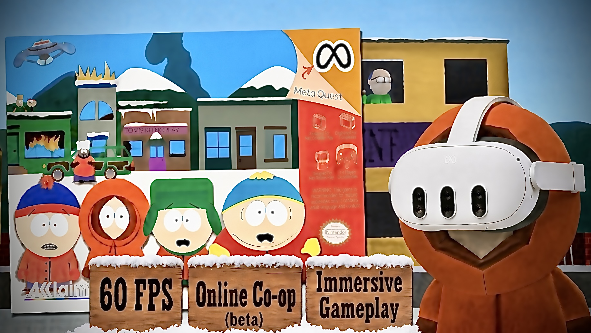
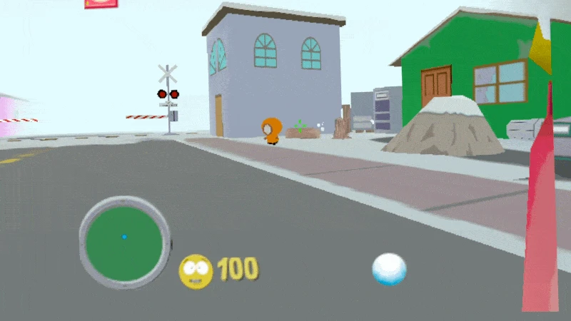

# South Park VR: Meta Quest 3 Standalone

South Park (N64) running natively on the Meta Quest 3, in VR: look around with your headset and the game's camera follows.

> **⚠️ YOU MUST OWN THE GAME.** This project does not include South Park or any of its assets. Bring your own ROM, made from your own cartridge (South Park, USA). No ROM is included or given out. Do not ask for ROMs.

## Features

- **60 FPS:** smooth in-between pictures on top of the game's own frames.
- **Two cameras, your choice** (pick one in the start window, or click the **right stick** in game to switch; the new camera's name pops up in red):
  - **Head aim:** look around with the headset; the game's camera and your snowballs follow your head. Smooth, with no black edges when you turn.
  - **Wrap-around:** a big curved screen that stays in the room; turn with the right stick.
- **Floating HUD:** health and ammo on a panel in front of you.
- **Straight to the title:** the intro screens are skipped.
- **Smooth turning** with the right stick.
- **Online co-op (BETA):** play story mode with a friend, each on their own Quest, with a 4-digit room code. You can't pick each other up, and the boys you two play as are left out of the level, so there are no doubles.
- **Plug and play:** pick your ROM (any file name) in the start window and play.

## Install

1. Download the APK from the [Releases](../../releases) page.
2. Install it with SideQuest (or `adb install`).
3. Start it from **Library > Unknown Sources**.
4. In the start window, choose your South Park (USA) ROM. The game checks the file and remembers it; after that just press **Play**.

## Controls

| Button | Action |
|---|---|
| Left stick | Walk / strafe |
| Right stick | Turn |
| A or left trigger | Jump |
| B | Change weapon |
| Right trigger | Throw |
| Y | L |
| Left menu button | Start / pause |
| Right stick click | Switch the camera (head aim / wrap-around) |

Tip: turn on **Options > Crosshairs** to see where your snowballs go.

## Online co-op (BETA)

1. Both players use the same version of the app.
2. One player taps **Online co-op: host a room** and tells the friend the 4-digit code; the friend taps **Online co-op: join a room** and types it.
3. The game starts on both headsets once you're paired.

Players find each other through a small free Cloudflare Worker relay. Only game inputs pass through it; no game data or ROM does.

## What's new in 0.1.0

- First release.

- KNOWN BUGS:
geometry flickers every now and then

## Credits

Built on [N64Recomp](https://github.com/N64Recomp/N64Recomp), [N64ModernRuntime](https://github.com/N64Recomp/N64ModernRuntime) and [RT64](https://github.com/rt64/rt64). South Park is a trademark of its owners; this is an unofficial fan project.
